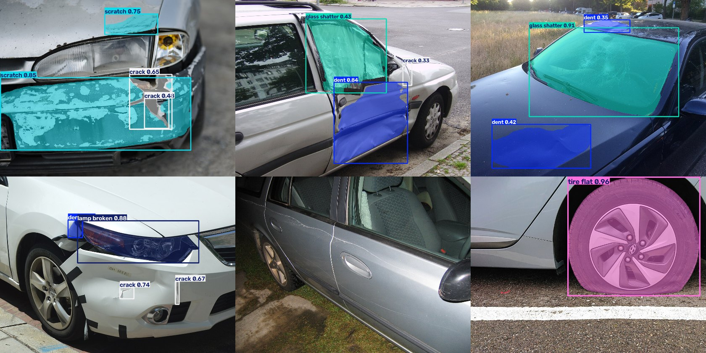
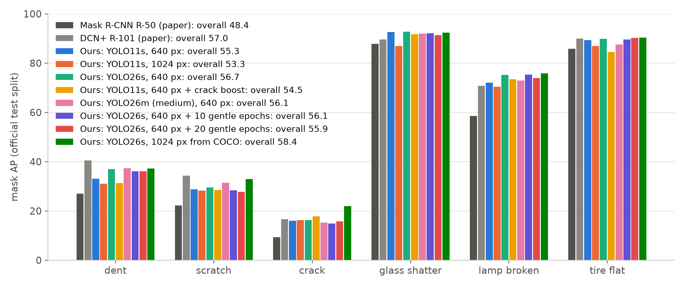
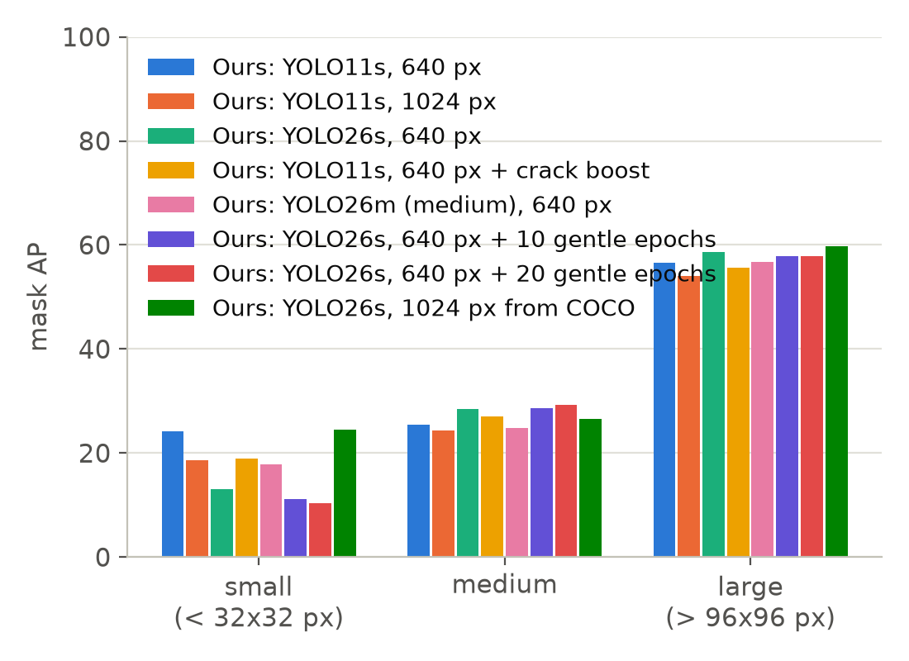
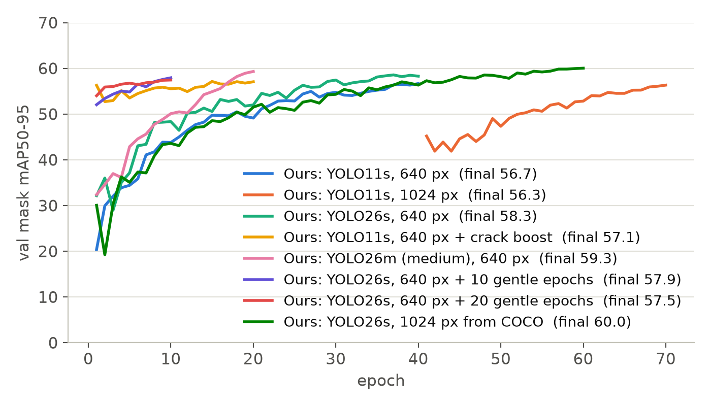

# Car Damage Detection and Segmentation with YOLO on the CarDD Dataset

**An AI model that looks at a photo of a damaged car, outlines every dent, scratch, crack, shattered window, broken lamp and flat tyre, names the car part under each damage, and writes a first damage report.** Built for vehicle damage assessment in insurance claims and accident repair. This repository holds the trained weights, a benchmark of eight YOLO models against the CarDD paper, the full training recipe, a live demo and an honest account of what works and what does not.

[](#how-to-run-it-yourself)
[](#how-to-run-it-yourself)
[](https://github.com/ultralytics/ultralytics)
[](https://cardd-damage-demo-280701910737.europe-west2.run.app)
[](LICENSE)
[](#results-eight-yolo-models-compared-on-cardd)

**[Try the live demo](https://cardd-damage-demo-280701910737.europe-west2.run.app)** · **[Download the weights](#trained-weights-download-and-use)** · **[See the results](#results-eight-yolo-models-compared-on-cardd)** · **[How it was built](#how-it-was-built)** · **[FAQ](#faq)**



*The best model on six photos from Wikimedia Commons it had never seen (credits in `samples/CREDITS.md`), at a 0.25 confidence threshold. The keyed-paint scratch in the bottom middle is missed: thin damage is the known weak spot, and it is measured, not hidden.*

## Contents

1. [What this project does](#what-this-project-does)
2. [Headline numbers](#headline-numbers)
3. [Results: eight YOLO models compared on CarDD](#results-eight-yolo-models-compared-on-cardd)
4. [Trained weights: download and use](#trained-weights-download-and-use)
5. [Car part detection for panel names](#car-part-detection-for-panel-names)
6. [The live demo and the damage report](#the-live-demo-and-the-damage-report)
7. [How it was built](#how-it-was-built)
8. [How to run it yourself](#how-to-run-it-yourself)
9. [Lessons from the experiments](#lessons-from-the-experiments)
10. [Limitations, said plainly](#limitations-said-plainly)
11. [Repository map](#repository-map)
12. [FAQ](#faq)
13. [Credits, citations and licences](#credits-citations-and-licences)
14. [About the author](#about-the-author)

## What this project does

- **Finds damage in a photo and draws its exact outline.** This is instance segmentation: every damage gets a pixel mask, a class and a confidence, so you know not just *that* a car is scratched but *where* and *how much*.
- **Six damage types**: dent, scratch, crack, glass shatter, broken lamp, flat tyre. These are the classes of the CarDD dataset, the largest public dataset for car damage detection.
- **Names the car part under each damage** with a second model trained on a public car-parts dataset: "scratch on the front-left door, 12% of the panel".
- **Turns detections into a first damage report**: a severity band from the outline's size, a repair route (paint only, panel repair and paint, weld or replace, glass, lamp unit, tyre) and a review flag that sends low-confidence detections to a person.
- **Benchmarks eight YOLO training runs** (YOLO11 and YOLO26, small and medium, 640 and 1024 pixel inputs) against the published CarDD baselines, all scored once on the official test split with the paper's own scoring program.
- **Ships as a live Streamlit demo**, as PyTorch weights, and as an ONNX file that runs on a plain CPU.

Who this is for: insurers and claims teams automating first-notice-of-loss photo triage, bodyshops and accident repair groups estimating from customer photos, fleet operators, and anyone benchmarking YOLO segmentation on CarDD or looking for pretrained car damage detection weights.

## Headline numbers

| | |
|---|---|
| Best mask AP on the official CarDD test split (374 photos) | **58.4**, against 57.0 for the best model in the CarDD paper (DCN+ R-101) and 48.4 for its Mask R-CNN |
| Box AP of the same model | **62.4**, against the paper's 60.6 |
| Model size and speed | 11.5 M parameters, 22 MB file, 414 ms per photo on a laptop CPU with no graphics card, 21.6 ms on the laptop GPU |
| ONNX export | 42.0 MB, 268 ms per photo on CPU |
| Training budget | 8 damage runs plus one car-part model, 35 hours in total on one Apple M2 Max laptop, no cloud GPU |
| Car-part model | 70.4 mask mAP50-95 on the Carparts test split |

## Results: eight YOLO models compared on CarDD

Every run was scored once on the official CarDD test split with pycocotools, the same program and split the paper used, so the numbers below sit in the same table as the published ones. Per-class columns are mask AP (mAP50-95). CPU time is one photo on a laptop CPU.

| Weights | Model | Input px | Epochs | Mask AP | Box AP | dent | scratch | crack | glass | lamp | tyre | CPU ms | What it tests |
|---|---|---|---|---|---|---|---|---|---|---|---|---|---|
| [yolo26s-seg_1024](weights_trained/yolo26s-seg_1024/) | YOLO26s-seg | 1024 | 60 | **58.4** | 62.4 | 37.2 | 33.0 | 21.9 | 92.4 | 75.8 | 90.3 | 414 | the best run: full-resolution training from the start |
| [yolo26s-seg_640](weights_trained/yolo26s-seg_640/) | YOLO26s-seg | 640 | 40 | **56.7** | 61.0 | 37.0 | 29.5 | 16.3 | 92.7 | 75.2 | 89.8 | 132 | the 640 px baseline of the same model |
| [yolo26m-seg_640](weights_trained/yolo26m-seg_640/) | YOLO26m-seg | 640 | 20 | **56.1** | 60.6 | 37.4 | 31.4 | 15.3 | 92.0 | 72.9 | 87.6 | 295 | the medium model, half the epochs |
| [yolo26s-seg_640_cont](weights_trained/yolo26s-seg_640_cont/) | YOLO26s-seg | 640 | 10 | **56.1** | 60.7 | 36.1 | 28.4 | 14.9 | 92.1 | 75.4 | 89.6 | 105 | a finished run continued for 10 gentle epochs |
| [yolo26s-seg_640_cont2](weights_trained/yolo26s-seg_640_cont2/) | YOLO26s-seg | 640 | 10 | **55.9** | 60.0 | 36.1 | 27.8 | 15.8 | 91.4 | 73.9 | 90.2 | 111 | that continuation continued for 10 more |
| [yolo11s-seg_640](weights_trained/yolo11s-seg_640/) | YOLO11s-seg | 640 | 40 | **55.3** | 59.9 | 33.1 | 28.8 | 16.0 | 92.6 | 72.0 | 89.3 | 107 | the previous YOLO generation, same recipe |
| [yolo11s-seg_640_bal](weights_trained/yolo11s-seg_640_bal/) | YOLO11s-seg | 640 | 20 | **54.5** | 59.6 | 31.3 | 28.5 | 17.8 | 91.8 | 73.4 | 84.5 | 131 | crack boost: crack photos shown 3x per epoch plus copy-paste |
| [yolo11s-seg_1024](weights_trained/yolo11s-seg_1024/) | YOLO11s-seg | 1024 | 30 | **53.3** | 57.1 | 31.0 | 28.3 | 16.3 | 86.9 | 70.4 | 86.9 | 382 | a finished 640 px model continued at 1024 px |

Published baselines on the same split (Wang, Li and Wu, 2023): Mask R-CNN R-50 **48.4** mask AP, DCN+ R-101 **57.0** mask AP and 60.6 box AP, with about 44 M and 63 M parameters.







## Trained weights: download and use

All weights are in this repository under `weights_trained/<run>/best.pt`, each beside the exact training settings (`args.yaml`) and the per-epoch curves (`results.csv`). The full model card of every run, with per-class, per-size and speed numbers, is in [`weights_trained/README.md`](weights_trained/README.md).

| File | Architecture | Params | Input px | Epochs | Training time | Size | Mask AP | Box AP |
|---|---|---|---|---|---|---|---|---|
| `weights_trained/yolo26s-seg_1024/best.pt` | YOLO26s-seg | 11.5 M | 1024 | 60 | 12.7 h | 22 MB | **58.4** | 62.4 |
| `weights_trained/yolo26s-seg_640/best.pt` | YOLO26s-seg | 11.5 M | 640 | 40 | 4.3 h | 22 MB | **56.7** | 61.0 |
| `weights_trained/yolo26m-seg_640/best.pt` | YOLO26m-seg | 27.1 M | 640 | 20 | 3.1 h | 52 MB | **56.1** | 60.6 |
| `weights_trained/yolo26s-seg_640_cont/best.pt` | YOLO26s-seg | 11.5 M | 640 | 10 | 0.9 h | 22 MB | **56.1** | 60.7 |
| `weights_trained/yolo26s-seg_640_cont2/best.pt` | YOLO26s-seg | 11.5 M | 640 | 10 | 0.9 h | 22 MB | **55.9** | 60.0 |
| `weights_trained/yolo11s-seg_640/best.pt` | YOLO11s-seg | 10.1 M | 640 | 40 | 2.3 h | 20 MB | **55.3** | 59.9 |
| `weights_trained/yolo11s-seg_640_bal/best.pt` | YOLO11s-seg | 10.1 M | 640 | 20 | 1.4 h | 20 MB | **54.5** | 59.6 |
| `weights_trained/yolo11s-seg_1024/best.pt` | YOLO11s-seg | 10.1 M | 1024 | 30 | 3.7 h | 20 MB | **53.3** | 57.1 |
| `weights_trained/parts_yolo26s_640/best.pt` | YOLO26s-seg, 23 car-part classes | 11.5 M | 640 | 40 | 5.5 h | 22 MB | 70.4 (Carparts test) | 72.6 |

Use them with Ultralytics in three lines:

```python
from ultralytics import YOLO
model = YOLO("weights_trained/yolo26s-seg_1024/best.pt")          # the best damage model
result = model.predict("photo.jpg", imgsz=1024, conf=0.25)[0]       # result.masks, result.boxes, result.names
result.show()                                                        # or result.plot() for an annotated image array
```

Export to ONNX for a CPU-only PC or a phone app: `yolo export model=weights_trained/yolo26s-seg_1024/best.pt format=onnx imgsz=1024` (or run `src/export_onnx.py`).

Class ids 0 to 5 are `dent, scratch, crack, glass shatter, lamp broken, tire flat` (CarDD's own names). The car-part model's 23 class names are in its `args.yaml` data file and in `src/panels.py`.

**Licence of the weights.** They were trained with Ultralytics YOLO, so they are released under the same AGPL-3.0 licence as this repository, and they were trained on CarDD, which is licensed for non-commercial research only. Use them for research, education and evaluation; a commercial product needs its own training data and either an Ultralytics Enterprise licence or an Apache-licensed detector.

## Car part detection for panel names

A damage report needs the panel, not just the damage. A second YOLO26s-seg model was trained on the Ultralytics Carparts segmentation dataset (23 classes: bonnet, doors, bumpers, lamps, mirrors, wheels, windows and more; CC BY 4.0). On its own test split it scores 70.4 mask mAP50-95 and 86.5 mask mAP50. `src/panels.py` joins the two models: each damage is assigned to the part it overlaps most, if at least half of the damage sits inside that part, and reported as a share of that panel. Left and right are the car's own sides; where the dataset's label has no side, it is filled in from the viewpoint.

Measured honestly on CarDD photos, which are mostly close-ups, the panel is named for only about one damage in seven at the demo's confidence bar of 0.6; on wider photos of a whole car it names the big parts well. The fix is part labels on real claim photos, not a bigger model.

## The live demo and the damage report

**[https://cardd-damage-demo-280701910737.europe-west2.run.app](https://cardd-damage-demo-280701910737.europe-west2.run.app)**

Upload a photo or pick a sample, choose any of the trained models, and move the confidence slider to see the trade-off between missed damage and false alarms. The page shows the outlines, a table of every detection with its class, confidence, area, panel and review flag, and a plain-language summary. A second page, *Method and results*, is the long write-up of the whole project: the dataset, the model choice, the exact recipe, the scoring, every run's lessons and the problems met on the way.

The first visit after a quiet spell can take up to a minute while the demo wakes up.

## How it was built

1. **Data.** CarDD's COCO-format labels were converted to YOLO polygon labels with the official train, validation and test split kept exactly (`src/prepare_data.py`). CarDD has 4,000 photos and 8,740 labelled damages; every photo is 1,000 pixels on its long side, and more than half contain more than one damage.
2. **Training.** Ultralytics YOLO segmentation models were fine-tuned from COCO-pretrained weights on an Apple M2 Max (Metal GPU), one run at a time, overnight, with a half-hourly health check that detected stalled runs and backed up weights (`run_experiments*.sh`, `check_training.sh`). The default optimiser setting resolved to AdamW at a learning rate of 0.001.
3. **Experiments.** Two model generations (YOLO11, YOLO26), two sizes (small, medium), two input resolutions (640, 1024), a crack-oversampling run with copy-paste augmentation, and three continuation runs that test whether a finished model can be pushed further.
4. **Scoring.** Each run was scored once on the official test split with pycocotools (`src/evaluate.py`), the same program the paper used, and never tuned against the test split. Validation was used for every decision.
5. **Figures and tables** are generated from the saved score files (`src/figures.py`), so no number is typed by hand.
6. **Panel names.** A car-part model was trained on the Carparts dataset with horizontal flips disabled, because the labels distinguish left from right (`run_experiments_6.sh`), and joined to the damage outlines (`src/panels.py`). Its usefulness on CarDD close-ups was measured, not assumed (`src/parts_check.py`).
7. **Product layer.** The Streamlit demo turns outlines into a report with severity bands, repair routes and review flags (`src/demo.py`).
8. **Packaging.** ONNX export for other runtimes (`src/export_onnx.py`), and a Streamlit app that works offline with the sample photos.

Software: Python 3.12, PyTorch 2.15, Ultralytics 8.4.201, pycocotools 2.0.11, Streamlit 1.66. Hardware: Apple M2 Max, 38-core GPU, 32 GB.

## How to run it yourself

You need Python 3.12, git and about 2 GB of free disk. A graphics card is optional: the demo runs on a CPU, and training
works on an Apple Silicon Mac (Metal), on an NVIDIA card (CUDA), or slowly on a CPU.

**Step 1. Get the code and the weights.** The trained models are inside the repository, so one clone is enough.

```bash
git clone https://github.com/CaptiveON/CarDamageClaimAutomation.git
cd CarDamageClaimAutomation
```

**Step 2. Create a virtual environment and install the libraries.**

```bash
python3.12 -m venv .venv
.venv/bin/pip install -r requirements.txt
```

On Windows, write `.venv\Scripts\pip` and `.venv\Scripts\streamlit` wherever `.venv/bin/...` appears below. If you have an
NVIDIA card, install the matching PyTorch build from pytorch.org first; otherwise the build that `pip` picks is fine.

**Step 3. Start the demo.**

```bash
.venv/bin/streamlit run src/app.py
```

Your browser opens at http://localhost:8501 (add `--server.port 8502` if that port is busy). Pick a sample photo or upload
your own, choose a model in the sidebar and move the confidence slider. The first photo takes a few seconds while the model
loads; after that each photo takes about half a second on a CPU with a 640 px model and one to two seconds with the 1024 px
model. The second page, *Method and results*, reads the saved scores from `results/` and needs nothing else.

**Step 4 (optional). Use a model in your own code.** See the three-line example under [Trained weights](#trained-weights-download-and-use).

**Step 5 (optional). Retrain or re-score.** This needs the CarDD dataset, which is not included.

1. Request CarDD from its authors (link under Credits) and unzip it so that `Dataset/CarDD_COCO/annotations/instances_train2017.json`
   exists, with the matching `val` and `test` files and image folders beside it.
2. Convert the labels to YOLO format and keep the official split: `.venv/bin/python src/prepare_data.py` writes `data/cardd_yolo/`.
3. Train. The best recipe, as it ran:
   ```bash
   yolo segment train model=yolo26s-seg.pt data=data/cardd_yolo/cardd.yaml imgsz=1024 batch=4 epochs=60 device=mps cache=ram
   ```
   Use `device=0` on an NVIDIA card or `device=cpu` otherwise; Ultralytics downloads the starting weights by itself. Every run
   lands in `runs/<name>/` with `weights/best.pt`, `results.csv` and its curves. On an Apple M2 Max the 640 px, 40-epoch
   version (`imgsz=640 batch=8 epochs=40`) took about 4 hours and this 1024 px run about 13. The exact command of every other
   run is in `run_experiments.sh` to `run_experiments_6.sh`; the crack-boost run first needs `.venv/bin/python src/make_balanced_train.py`.
4. Score a run once on the official test split: `.venv/bin/python src/evaluate.py runs/<name> cpu` writes `results/<name>/summary.json`
   and `summary.md`.
5. Make the demo offer the new model: copy `runs/<name>/weights/best.pt` to `weights_trained/<name>/best.pt`. The demo lists every
   folder there that has a matching `results/<name>/summary.json`, best score first.
6. Redraw the figures from the saved scores: `.venv/bin/python src/figures.py` and `.venv/bin/python src/dataset_figure.py`.
7. For the panel names, train the car-part model on the Carparts dataset, which Ultralytics downloads on first use, then put
   its `best.pt` at `weights_trained/parts_yolo26s_640/best.pt`:
   ```bash
   yolo segment train model=yolo26s-seg.pt data=carparts-seg.yaml imgsz=640 batch=8 epochs=40 patience=10 fliplr=0.0 device=mps
   ```
   `.venv/bin/python src/parts_check.py` then measures how often it names the panel on CarDD photos.
8. Export the best model to ONNX and time it: `.venv/bin/python src/export_onnx.py` writes `results/export.json`.

If something does not start: `device=mps` needs macOS 13 or newer; a slow page usually means the 1024 px model on a weak
CPU, so pick a 640 px model in the sidebar; and a missing `results/<name>/summary.json` is why a trained model does not
appear in the demo.

## Lessons from the experiments

- **Resolution has to be trained in.** Training at 1024 px from the start beat the same recipe at 640 px by 1.7 mask AP and almost doubled the score on small damage (13.1 to 24.5). Continuing a finished 640 px model at 1024 px lost 2 points instead. Tiling photos at inference time was tried too and found harmful.
- **Restarting a finished run costs a dip** that ten or twenty gentle extra epochs do not recover. Both continuation runs ended below the run they started from. Plan the full schedule up front.
- **Oversampling the rare class works, with a side effect.** Showing crack photos three times per epoch plus copy-paste lifted crack from 16.0 to 17.8 and cost 0.8 overall. A targeted fix moves the target.
- **Recipe and budget moved the result more than architecture.** The spread between the best and worst run is 5.1 points, and every choice behind it was a data or training choice. YOLO26s beat YOLO11s by 1.4 at 640 px; the medium model, trained for half the epochs, did not beat the small one.
- **Score once, on the official split, with the official program.** It is the only way the numbers can be compared with the paper's, and the reason the headline here can be trusted.

## Limitations, said plainly

- Thin damage is not solved: crack is 21.9 mask AP for the best run, better than the paper's 16.6 and still the weakest class by far.
- CarDD is stock photography. A model of this kind that scores 58 on CarDD has been reported to score 29 on another damage dataset; nobody has published results on real claim photos. Measuring that gap is the first step for any real deployment.
- There are no undamaged cars in the training data, so the false-alarm rate on a clean car is untested.
- A photo cannot show hidden or structural damage. This is triage and parts pre-ordering, not a final repair bill.
- Panel names work on whole-car photos and mostly say "unknown" on close-ups.
- The severity bands and review thresholds in the demo are illustrative placeholders; in production they come from the cost of a missed repair against the cost of a wasted review.

## Repository map

| Looking for... | Open... |
|---|---|
| the trained weights, their settings and curves | `weights_trained/<run>/` and the model cards in `weights_trained/README.md` |
| every run's test scores as numbers | `results/<run>/summary.json` |
| the figures | `results/*.png`, drawn by `src/figures.py` and `src/dataset_figure.py` |
| converting CarDD labels to YOLO format | `src/prepare_data.py` |
| the training commands, one chain per file | `run_experiments.sh` to `run_experiments_6.sh` |
| the crack-oversampled training set | `src/make_balanced_train.py` |
| the overnight training health check | `check_training.sh` |
| scoring a run on the official test split | `src/evaluate.py` |
| the demo page: detection, panel names, damage report | `src/demo.py` |
| naming the panel under each damage | `src/panels.py`, measured by `src/parts_check.py` |
| the long write-up of method, results and lessons | `src/research.py` (the demo's second page) |
| the ONNX export and its timing | `src/export_onnx.py`, `results/export.json` |
| the site entry point and theme | `src/app.py`, `.streamlit/config.toml` |
| sample photos and their licences | `samples/`, `samples/CREDITS.md` |

## FAQ

**Which YOLO model is best for car damage detection on CarDD?**
In these experiments, YOLO26s-seg trained at 1024 px for 60 epochs: 58.4 mask AP and 62.4 box AP on the official test split, above the paper's best published model with a fifth of its parameters. The same model at 640 px scores 56.7 and runs three times faster.

**How does this compare with the CarDD paper?**
The paper's best model, DCN+ with a ResNet-101 backbone, reports 57.0 mask AP and 60.6 box AP. The best run here beats both with an 11.5 M parameter model that runs on a CPU.

**Can I use the weights in a commercial product?**
Not as they are. CarDD is licensed for non-commercial research, and Ultralytics YOLO is AGPL-3.0. For a product, train on your own photos and either buy an Ultralytics Enterprise licence or swap in an Apache-licensed detector; the pipeline is built so that swap is small.

**Does it work on real insurance claim photos?**
Unknown, and that is said on the demo too. CarDD is stock photography; expect a drop on phone photos taken in a yard, and measure it on your own held-out set before trusting any number.

**How long does training take, and do I need a GPU?**
The best run took 12.7 hours on an Apple M2 Max laptop; the 640 px runs took 2 to 4 hours. A CUDA GPU is faster but not required.

**What is mask AP?**
The standard accuracy score for segmentation: for each class, how much of the damage is found without false alarms, averaged over confidence cut-offs and over how tightly the outline must match (overlap from 50% to 95%). 100 is perfect. Box AP is the same score on rectangles instead of outlines.

**Where is the dataset?**
Not here. CarDD must be requested from its authors (see the paper site) and placed at `Dataset/CarDD_COCO/`. The demo works without it, using the committed weights and the freely licensed sample photos.

## Credits, citations and licences

This project stands on two pieces of public work, and both deserve the credit.

**CarDD dataset and paper.** Xinkuang Wang, Wenjing Li and Zhongcheng Wu, *CarDD: A New Dataset for Vision-based Car Damage Detection*, IEEE Transactions on Intelligent Transportation Systems, 2023. Dataset site: https://cardd-ustc.github.io. The dataset is for non-commercial research use and is not redistributed here.

```bibtex
@article{wang2023cardd,
  title   = {CarDD: A New Dataset for Vision-based Car Damage Detection},
  author  = {Wang, Xinkuang and Li, Wenjing and Wu, Zhongcheng},
  journal = {IEEE Transactions on Intelligent Transportation Systems},
  year    = {2023}
}
```

**Ultralytics YOLO.** The models are YOLO11 and YOLO26 segmentation models trained with the Ultralytics library, https://github.com/ultralytics/ultralytics, released under AGPL-3.0. This repository, including the trained weights, is released under the same licence; see [`LICENSE`](LICENSE).

```bibtex
@software{ultralytics_yolo,
  author  = {Jocher, Glenn and Qiu, Jing},
  title   = {Ultralytics YOLO},
  year    = {2024},
  url     = {https://github.com/ultralytics/ultralytics},
  license = {AGPL-3.0}
}
```

**Carparts segmentation dataset.** Curated by Ultralytics from the Roboflow project "car-seg" by Gianmarco Russo (2023), CC BY 4.0, used only for the panel-naming model. https://docs.ultralytics.com/datasets/segment/carparts-seg/

**Sample photos** are from Wikimedia Commons under public-domain and Creative Commons licences; every author and licence is listed in [`samples/CREDITS.md`](samples/CREDITS.md).

**pycocotools** for scoring, **Streamlit** for the demo, **PyTorch** underneath everything.

If this repository helps your work, cite it as: Mohammad Adnan, *Car Damage Detection and Segmentation with YOLO on the CarDD Dataset*, https://github.com/CaptiveON/CarDamageClaimAutomation, 2026.

## About the author

I am **Mohammad Adnan**, a machine-learning engineer who likes to take a computer-vision problem all the way from a dataset to something a person can click on. This project, built in a week on one laptop, shows the full loop:

- **Data engineering**: converting and validating a COCO segmentation dataset, keeping the official split intact, building an oversampled variant for a rare class.
- **Experiment design**: a controlled comparison across model generation, size, resolution, augmentation and training schedule, with every decision made on validation and the test split touched once.
- **Rigorous evaluation**: the paper's own scoring program, per-class and per-size analysis, speed measured on the hardware the model would really run on.
- **Modelling judgement**: choosing a small segmentation model over heavier published ones, and over foundation models and vision-language models, for reasons of cost, speed, licence and auditability.
- **Product thinking**: a second model for panel names, a damage report with severity, repair route and review flags, and thresholds framed as a business decision rather than a model setting.
- **Packaging**: ONNX export and a Streamlit app that works offline with sample photos.
- **Honesty**: limitations measured and written down, including the ones that make the headline less impressive.

GitHub: https://github.com/CaptiveON. I am open to roles and collaborations in computer vision and applied machine learning; open an issue here or message me on GitHub.

## Keywords

car damage detection, vehicle damage assessment, car damage segmentation, instance segmentation, YOLO, YOLO11, YOLO26, Ultralytics, CarDD dataset, CarDD benchmark, pretrained car damage weights, insurance claim automation, first notice of loss, accident repair estimating, bodyshop AI, dent detection, scratch detection, crack detection, car part segmentation, PyTorch, Streamlit, ONNX, computer vision portfolio project
